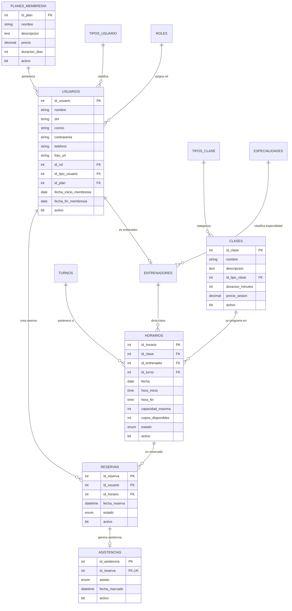
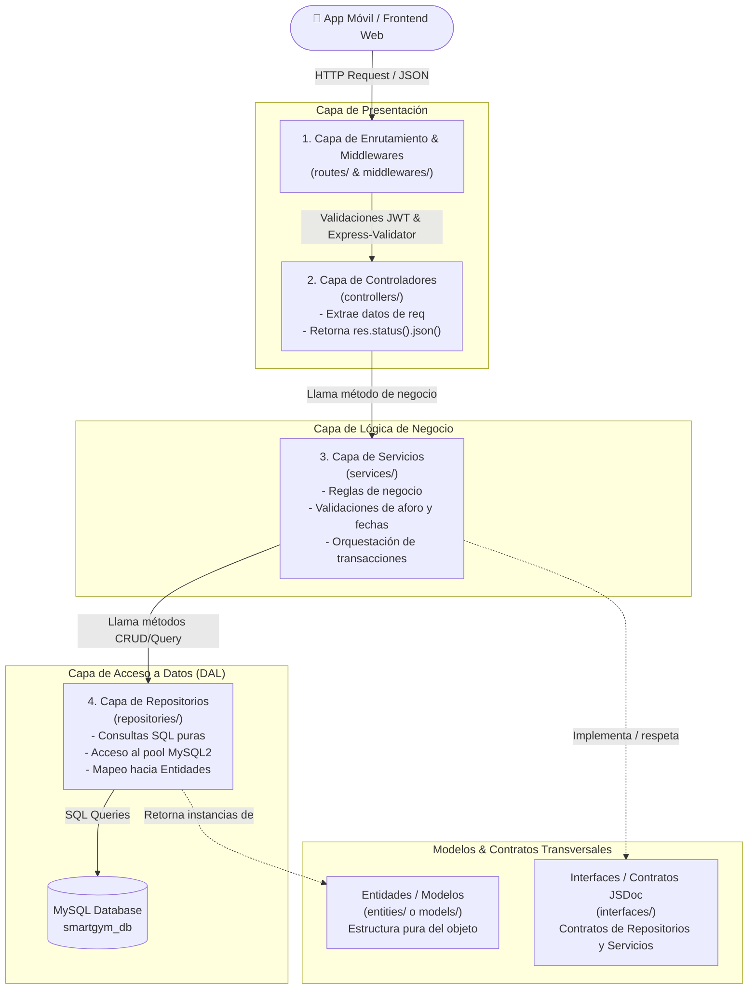

# 🏋️ SmartGym Backend - Documentación de Arquitectura y Base de Datos

Documentación técnica integral del backend de **SmartGym**, cubriendo la estructura actual, el modelo de datos MySQL y la propuesta de refactorización hacia una **Arquitectura en 4 Capas** (*Routes -> Controllers -> Services -> Repositories + Entities/Interfaces*).

---

## 📑 Tabla de Contenidos
1. [Visión General del Sistema](#-visión-general-del-sistema)
2. [Stack Tecnológico](#-stack-tecnológico)
3. [Estructura Actual del Proyecto (Por Módulos)](#-estructura-actual-del-proyecto-por-módulos)
4. [Base de Datos MySQL (`smartgym_db`)](#-base-de-datos-mysql-smartgym_db)
   - [Configuración de Conexión](#configuración-de-conexión)
   - [Esquema y Tablas del Sistema](#esquema-y-tablas-del-sistema)
5. [Módulos y Endpoints Existentes](#-módulos-y-endpoints-existentes)
6. [Nueva Propuesta: Arquitectura en 4 Capas](#-nueva-propuesta-arquitectura-en-4-capas)
   - [¿Por qué migrar a 4 capas?](#por-qué-migrar-a-4-capas)
   - [Diagrama de Flujo de la Arquitectura](#diagrama-de-flujo-de-la-arquitectura)
   - [Responsabilidad de cada Capa](#responsabilidad-de-cada-capa)
   - [Nueva Estructura de Carpetas Propuesta](#nueva-estructura-de-carpetas-propuesta)
   - [Ejemplo Práctico de Refactorización (Antes vs Después)](#ejemplo-práctico-de-refactorización-antes-vs-después)
7. [Plan de Migración Paso a Paso](#-plan-de-migración-paso-a-paso)

---

## 🌟 Visión General del Sistema

El backend de SmartGym es una API RESTful desarrollada para la gestión integral de un gimnasio:
* **Control de usuarios y autenticación:** Registro, login con JWT, roles (`cliente`, `entrenador`, `administrador`, `recepcionista`) y recuperación de contraseña.
* **Control de membresías:** Planes mensuales, semestrales, anuales y validación de vigencia.
* **Gestión de clases y horarios:** Catálogo de disciplinas, instructores asignados, turnos y aforo máximo.
* **Sistema de reservas con control de concurrencia:** Bloqueo pesimista (`FOR UPDATE`) y transacciones atómicas para garantizar que no se sobrepasen los cupos ni se generen cruces de horarios.
* **Asistencias:** Registro y verificación de asistencia presencial vinculada a la reserva.

---

## 🛠️ Stack Tecnológico

| Componente | Tecnología | Versión | Propósito |
| :--- | :--- | :--- | :--- |
| **Entorno de ejecución** | Node.js (ES Modules `"type": "module"`) | >= 18.x | Runtime asíncrono con sintaxis nativa `import/export` |
| **Framework HTTP** | Express.js | `^5.3.0` | Servidor web y enrutador de peticiones |
| **Motor de Base de Datos** | MySQL | 8.0+ / MariaDB | Motor relacional transaccional (InnoDB) |
| **Cliente de BD** | `mysql2/promise` | `^3.24.5` | Pool de conexiones con soporte de Promesas y async/await |
| **Seguridad y Criptografía** | `bcryptjs` | `^3.0.3` | Hashing seguro de contraseñas con sal |
| **Tokens de Sesión** | `jsonwebtoken` (JWT) | `^9.0.3` | Autenticación stateless y control de expiración |
| **Validaciones** | `express-validator` | `^7.3.2` | Sanitización y validación declarativa de datos de entrada |
| **Carga de Archivos** | `multer` | `^2.4.0` | Subida de imágenes de perfil al almacenamiento local (`/uploads`) |
| **Utilidades** | `cors`, `dotenv`, `morgan` | Recientes | Habilitación de CORS, variables de entorno y logger HTTP |

---

## 📂 Estructura del Proyecto (Arquitectura en 4 Capas - Implementada)

El backend de SmartGym implementa rigurosamente una **Arquitectura en 4 Capas** (*Routes -> Controllers -> Services -> Repositories + Entities*), logrando un desacoplamiento total entre las rutas HTTP, la lógica del negocio y el acceso a datos SQL:

```text
backend/
├── .env                       # Variables de entorno (DB, JWT, Puerto)
├── .env.example               # Plantilla de variables de entorno
├── package.json               # Dependencias y scripts npm
├── schema_info.json           # Metadatos del esquema de BD
├── test-api.js                # Suite de pruebas automatizadas end-to-end
├── uploads/                   # Archivos estáticos
│   └── profiles/              # Fotos de perfil de usuarios
└── src/
    ├── app.js                 # Configuración de Express, middlewares y montaje de rutas
    ├── server.js              # Inicialización HTTP y WebSocket Socket.IO
    ├── config/
    │   ├── db.js              # Pool de conexiones MySQL2 (Promise)
    │   ├── multer.js          # Almacenamiento local para avatares
    │   └── socket.js          # Notificaciones push y WebSockets en tiempo real
    ├── entities/              # Capa de Dominio / Entidades
    │   ├── Usuario.entity.js
    │   ├── Clase.entity.js
    │   ├── Horario.entity.js
    │   ├── Reserva.entity.js
    │   ├── Asistencia.entity.js
    │   └── Plan.entity.js
    ├── repositories/          # Capa 4: Acceso a Datos (DAL / Consultas SQL)
    │   ├── usuarios.repository.js
    │   ├── clases.repository.js
    │   ├── horarios.repository.js
    │   ├── reservas.repository.js
    │   ├── asistencias.repository.js
    │   ├── planes.repository.js
    │   ├── dashboard.repository.js
    │   └── entrenadores.repository.js
    ├── services/              # Capa 3: Lógica de Negocio y Transacciones
    │   ├── auth.service.js
    │   ├── perfil.service.js
    │   ├── clases.service.js
    │   ├── horarios.service.js
    │   ├── reservas.service.js
    │   ├── asistencias.service.js
    │   ├── planes.service.js
    │   ├── dashboard.service.js
    │   ├── entrenadores.service.js
    │   └── notificaciones.service.js
    ├── controllers/           # Capa 2: Controladores HTTP (req -> res)
    │   ├── auth.controller.js
    │   ├── perfil.controller.js
    │   ├── clases.controller.js
    │   ├── horarios.controller.js
    │   ├── reservas.controller.js
    │   ├── asistencias.controller.js
    │   ├── planes.controller.js
    │   ├── dashboard.controller.js
    │   ├── entrenadores.controller.js
    │   └── notificaciones.controller.js
    ├── routes/                # Capa 1: Enrutamiento y Middlewares
    │   ├── auth.routes.js
    │   ├── perfil.routes.js
    │   ├── clases.routes.js
    │   ├── horarios.routes.js
    │   ├── reservas.routes.js
    │   ├── asistencias.routes.js
    │   ├── planes.routes.js
    │   ├── dashboard.routes.js
    │   ├── entrenadores.routes.js
    │   └── notificaciones.routes.js
    ├── validators/            # Validadores con express-validator
    │   ├── auth.validator.js
    │   └── perfil.validator.js
    └── middlewares/           # Middlewares transversales (auth, role, validate, error)
        ├── auth.middleware.js
        ├── role.middleware.js
        ├── validate.middleware.js
        └── error.middleware.js
```

### Ventajas de la Arquitectura Implementada
* **Separación de Responsabilidades (SoC):** Cada capa tiene un objetivo único y claro.
* **Controladores Limpios:** Solo se encargan del protocolo HTTP (parámetros y códigos de estado `200`, `201`, `400`, `404`).
* **Servicios Robustos:** Contienen toda la lógica de validación, hashes con bcrypt, tokens JWT, orquestación de transacciones y cálculo de aforos.
* **Repositorios Aislados:** Concentran las consultas SQL parametrizadas con soporte nativo para transacciones transaccionales (`FOR UPDATE`, rollback y commit).

---

## 🗄️ Base de Datos MySQL (`smartgym_db`)

### Configuración de Conexión
Ubicación: `src/config/db.js`

El sistema utiliza un **Pool de Conexiones** de `mysql2/promise` para soportar alta concurrencia:
```javascript
export const pool = mysql.createPool({
  host: process.env.DB_HOST || 'localhost',
  user: process.env.DB_USER || 'root',
  password: process.env.DB_PASSWORD || '',
  database: process.env.DB_NAME || 'smartgym_db',
  port: Number(process.env.DB_PORT) || 3306,
  waitForConnections: true,
  connectionLimit: 10,
  queueLimit: 0,
});
```

### Esquema y Tablas del Sistema (12 Tablas)



#### Descripción de Tablas Principales:
1. `usuarios`: Cuenta de usuario, credenciales con hash bcrypt, perfil, llaves foráneas a roles y membresía vigente.
2. `roles`: Roles del sistema (`administrador`, `entrenador`, `cliente`, `recepcionista`).
3. `tipos_usuario`: Clasificación (`regular`, `estudiante`, `corporativo`, `vip`).
4. `planes_membresia`: Catálogo de membresías (`Mensual`, `Trimestral`, `Semestral`, `Anual`).
5. `clases`: Disciplinas disponibles (`Spinning`, `CrossFit`, `Yoga`, `Funcional`, `Musculación`).
6. `tipos_clase`: Categorías de clase (`Cardio`, `Fuerza`, `Flexibilidad`, `Alta Intensidad`).
7. `entrenadores`: Personal capacitado, vinculado a `usuarios` y `especialidades`.
8. `especialidades`: Áreas técnicas de los entrenadores.
9. `turnos`: Bloques horarios estándar (`Mañana`, `Tarde`, `Noche`).
10. `horarios`: Calendario de sesiones programadas con fecha, hora, capacidad máxima y **cupos disponibles calculados en tiempo real**.
11. `reservas`: Citas agendadas por los usuarios. Estados: `confirmada`, `cancelada`, `completada`.
12. `asistencias`: Marcación de ingreso físico al gimnasio vinculada a una reserva previa.

---

## 📡 Módulos y Endpoints Existentes

| Módulo | Método | Endpoint | Acceso | Descripción |
| :--- | :---: | :--- | :---: | :--- |
| **Health** | `GET` | `/api/health` | Público | Verificación del estado del servidor y base de datos |
| **Auth** | `POST` | `/api/auth/register` | Público | Registro de nuevos clientes |
| **Auth** | `POST` | `/api/auth/login` | Público | Inicio de sesión con retorno de token JWT |
| **Auth** | `POST` | `/api/auth/forgot-password` | Público | Solicitud de código demo para restablecimiento |
| **Auth** | `POST` | `/api/auth/reset-password` | Público | Cambio de contraseña con código de verificación |
| **Perfil** | `GET` | `/api/perfil` | JWT | Obtiene perfil del usuario logueado con membresía |
| **Perfil** | `PUT` | `/api/perfil` | JWT | Edita datos personales (teléfono, contactos) |
| **Perfil** | `PUT` | `/api/perfil/password` | JWT | Cambio de contraseña del usuario autenticado |
| **Perfil** | `POST` | `/api/perfil/avatar` | JWT | Subida de imagen de perfil vía Multer |
| **Planes** | `GET` | `/api/planes` | Público | Catálogo de planes de membresía activos |
| **Clases** | `GET` | `/api/clases` | Público | Catálogo de disciplinas activas |
| **Clases** | `GET` | `/api/clases/:id` | Público | Detalle de una disciplina específica |
| **Horarios** | `GET` | `/api/horarios` | Público | Listado de sesiones disponibles con aforo |
| **Horarios** | `GET` | `/api/horarios/clase/:id_clase`| Público | Horarios filtrados por disciplina |
| **Horarios** | `POST` | `/api/horarios` | JWT (Admin/Coach) | Programa horario. Admin asigna a cualquier entrenador; Entrenador solo a sí mismo |
| **Reservas** | `POST` | `/api/reservas` | JWT | Crea una reserva (con bloqueo pesimista y prohibición de auto-reserva a entrenadores) |
| **Reservas** | `GET` | `/api/reservas/mis-reservas` | JWT | Lista reservas activas e históricas del usuario |
| **Reservas** | `PUT` | `/api/reservas/:id/cancelar`| JWT | Cancela reserva y restaura automáticamente el cupo |
| **Reservas** | `PUT` | `/api/reservas/:id/reprogramar`| JWT | Reprograma cita a otro horario con límite de 24h y justificante opcional |
| **Dashboard**| `GET` | `/api/dashboard/admin` | JWT (Admin) | Métricas ejecutivas, KPIs, aforo en vivo y alertas para el dueño |
| **Notificaciones**| `POST`| `/api/notificaciones/enviar-prueba` | JWT | Emite señal en tiempo real al teléfono del usuario |
| **Entrenadores**| `GET` | `/api/entrenadores/mis-clases` | JWT (Coach) | Consulta de clases asignadas al entrenador con conteo de inscritos |
| **Entrenadores**| `GET` | `/api/entrenadores/clases/:id/alumnos` | JWT (Coach) | Lista de alumnos con asistencia de su clase (privada) |
| **Entrenadores**| `GET` | `/api/entrenadores/perfil` | JWT (Coach) | Perfil, tarifa y métricas de dictado del instructor |
| **Asistencias**| `POST` | `/api/asistencias/marcar` | JWT (Staff/Admin)| Registro de ingreso presencial |
| **Asistencias**| `GET` | `/api/asistencias/reserva/:id` | JWT | Consulta de asistencia por reserva |
| **Admin Usuarios**| `GET` | `/api/admin/usuarios` | JWT (Admin) | Listado y filtrado general de clientes, entrenadores y administradores |
| **Admin Roles**| `PUT` | `/api/admin/usuarios/:id/rol` | JWT (Admin) | Cambia el rol de un usuario (promover a entrenador / devolver a cliente) |
| **Admin Estado**| `PUT` | `/api/admin/usuarios/:id/estado` | JWT (Admin) | Activa o desactiva la cuenta de un usuario |
| **Admin Staff**| `GET` | `/api/admin/entrenadores` | JWT (Admin) | Directorio completo del personal de entrenadores activos con especialidades |

---

## 🏗️ Nueva Propuesta: Arquitectura en 4 Capas

### ¿Por qué migrar a 4 capas?
1. **Separación de Responsabilidades (SoC):** Cada parte del código hace una sola cosa bien.
2. **Desacoplamiento de la Base de Datos:** Si el día de mañana se cambia MySQL por PostgreSQL, Prisma o TypeORM, los controladores y servicios no cambian; solo se tocan los repositorios.
3. **Facilidad de Pruebas Unitarias:** Se pueden probar las reglas de negocio (Servicios) simulando (*mockeando*) los Repositorios sin necesidad de levantar una base de datos real.
4. **Reutilización:** Una consulta a la base de datos escrita en un repositorio puede ser llamada por múltiples servicios.

### Diagrama de Flujo de la Arquitectura



---

### Responsabilidad de cada Capa

#### 1. Capa de Rutas y Middlewares (`routes/`, `middlewares/`)
* **Qué hace:** Expone las URLs del API REST (`/api/reservas`, etc.).
* **Middlewares:**
  * `authenticateToken`: Extrae y valida el JWT.
  * `requireRole`: Controla si el usuario tiene permiso (ej. admin, entrenador).
  * `validate`: Evalúa las reglas de `express-validator` y rechaza la petición con 422 si hay datos inválidos antes de entrar al controlador.
* **Qué NO hace:** No ejecuta lógica de negocio ni consultas a la base de datos.

#### 2. Capa de Controladores (`controllers/`)
* **Qué hace:** Actúa como puente entre el protocolo HTTP y el sistema:
  * Extrae parámetros: `req.params`, `req.query`, `req.body`, `req.user`.
  * Invoca el método correspondiente del **Servicio**.
  * Construye la respuesta HTTP uniforme (`res.status(200).json({ ok: true, data: ... })`).
  * Atrapa excepciones y las pasa al `next(error)`.
* **Qué NO hace:** No contiene consultas SQL (`SELECT`, `INSERT`), ni gestiona transacciones de BD directamente.

#### 3. Capa de Servicios (`services/`)
* **Qué hace:** Es el núcleo de la aplicación (Reglas de Negocio):
  * Comprueba si el usuario tiene membresía vigente antes de permitirle reservar.
  * Verifica si hay cruces de horario para el usuario en la misma fecha y hora.
  * Encripta contraseñas con `bcryptjs`.
  * Genera tokens JWT.
  * Orquesta operaciones atómicas (ej. si una reserva requiere descontar un cupo y crear el registro, coordina la llamada a los repositorios).
* **Qué NO hace:** No conoce de `req` ni `res` (completamente agnóstico al protocolo HTTP).

#### 4. Capa de Repositorios (`repositories/`)
* **Qué hace:** Es la única capa que interactúa con la base de datos:
  * Ejecuta consultas SQL parametrizadas usando el `pool` de MySQL.
  * Soporta recibir una conexión existente para transacciones (`connection.query(...)`).
  * Métodos típicos: `findById`, `findAll`, `create`, `update`, `delete`, `findByEmail`, `lockHorarioForUpdate`.
* **Qué NO hace:** No toma decisiones de negocio ni valida reglas HTTP.

#### 5. Capa de Entidades / Modelos (`entities/` o `models/`)
* **Qué hace:** Define la estructura y molde de los objetos del dominio:
  * `UsuarioEntity.js`, `ClaseEntity.js`, `HorarioEntity.js`, `ReservaEntity.js`, `PlanEntity.js`.
  * Normaliza los datos (por ejemplo, convertir el `bit(1)` de MySQL a un booleano estándar `true/false`, formatear fechas ISO).

#### 6. Interfaces / Contratos (`interfaces/`)
* **Qué hace:** En JavaScript moderno (usando JSDoc o contratos base), define la firma que todo repositorio o servicio debe cumplir:
  * `@typedef {Object} IReservaRepository`
  * Asegura consistencia en los nombres de métodos (`findById`, `create`, etc.) y autocompletado en el editor.

---

### Nueva Estructura de Carpetas Propuesta

Existen dos opciones estándar para organizar las 4 capas:

#### Opción A: Por Capas Técnicas Globales (Recomendada para esta refactorización)
```text
src/
├── config/                     # Conexiones (db.js, multer.js)
├── constants/                  # Constantes del sistema (roles, estados de reserva)
├── entities/                   # Modelos / Entidades de dominio
│   ├── Usuario.entity.js
│   ├── Clase.entity.js
│   ├── Horario.entity.js
│   ├── Reserva.entity.js
│   └── Plan.entity.js
├── repositories/               # Capa 4: Acceso a Datos (SQL puro)
│   ├── interfaces/             # Contratos JSDoc de repositorios
│   ├── usuarios.repository.js
│   ├── clases.repository.js
│   ├── horarios.repository.js
│   ├── reservas.repository.js
│   ├── asistencias.repository.js
│   └── planes.repository.js
├── services/                   # Capa 3: Reglas de Negocio
│   ├── auth.service.js
│   ├── perfil.service.js
│   ├── clases.service.js
│   ├── horarios.service.js
│   ├── reservas.service.js
│   ├── asistencias.service.js
│   └── planes.service.js
├── controllers/                # Capa 2: Manejadores HTTP
│   ├── auth.controller.js
│   ├── perfil.controller.js
│   ├── clases.controller.js
│   ├── horarios.controller.js
│   ├── reservas.controller.js
│   ├── asistencias.controller.js
│   └── planes.controller.js
├── routes/                     # Capa 1: Definición de rutas HTTP
│   ├── index.js                # Router centralizador
│   ├── auth.routes.js
│   ├── perfil.routes.js
│   ├── clases.routes.js
│   ├── horarios.routes.js
│   ├── reservas.routes.js
│   ├── asistencias.routes.js
│   └── planes.routes.js
├── middlewares/                # Middlewares (auth, role, validate, error)
├── utils/                      # Funciones utilitarias (JWT, fechas, bcrypt)
├── app.js                      # Configuración de Express
└── server.js                   # Inicio del servidor
```

#### Opción B: Híbrida (Por Módulos con 4 Capas Internas)
```text
src/
├── modules/
│   ├── planes/
│   │   ├── planes.entity.js       # Entidad
│   │   ├── planes.repository.js   # Repositorio (SQL)
│   │   ├── planes.service.js      # Servicio (Regla de negocio)
│   │   ├── planes.controller.js   # Controlador (HTTP)
│   │   └── planes.routes.js       # Rutas
```
> **Nota:** La **Opción A** proporciona una separación limpia de capas a nivel global muy valorada en proyectos académicos y empresariales estructurados.

---

### Ejemplo Práctico de Refactorización (Antes vs Después)

Tomemos como ejemplo el módulo de **Planes de Membresía**:

#### ❌ ANTES (Controlador acoplado a SQL)
```javascript
// src/modules/planes/planes.controller.js
import { pool } from '../../config/db.js';

export const getAllPlanes = async (req, res, next) => {
  try {
    const [planes] = await pool.query(
      `SELECT id_plan, nombre, descripcion, precio, duracion_dias
       FROM planes_membresia
       WHERE activo = 1
       ORDER BY precio ASC`
    );
    res.json({ ok: true, total: planes.length, data: { planes } });
  } catch (error) {
    next(error);
  }
};
```

---

#### ✅ DESPUÉS (Arquitectura en 4 Capas)

##### 1. Entidad (`src/entities/Plan.entity.js`)
```javascript
export class PlanEntity {
  constructor({ id_plan, nombre, descripcion, precio, duracion_dias, activo }) {
    this.id = id_plan;
    this.nombre = nombre;
    this.descripcion = descripcion;
    this.precio = Number(precio);
    this.duracionDias = duracion_dias;
    this.activo = Buffer.isBuffer(activo) ? activo[0] === 1 : Boolean(activo);
  }
}
```

##### 2. Repositorio (`src/repositories/planes.repository.js`)
```javascript
import { pool } from '../config/db.js';
import { PlanEntity } from '../entities/Plan.entity.js';

export class PlanesRepository {
  async findAllActivos() {
    const [rows] = await pool.query(
      `SELECT id_plan, nombre, descripcion, precio, duracion_dias, activo
       FROM planes_membresia
       WHERE activo = 1
       ORDER BY precio ASC`
    );
    return rows.map((row) => new PlanEntity(row));
  }

  async findById(id) {
    const [rows] = await pool.query(
      `SELECT id_plan, nombre, descripcion, precio, duracion_dias, activo
       FROM planes_membresia
       WHERE id_plan = ?`,
      [id]
    );
    if (rows.length === 0) return null;
    return new PlanEntity(rows[0]);
  }
}

export const planesRepository = new PlanesRepository();
```

##### 3. Servicio (`src/services/planes.service.js`)
```javascript
import { planesRepository } from '../repositories/planes.repository.js';

export class PlanesService {
  constructor(repository = planesRepository) {
    this.repository = repository;
  }

  async listarPlanesActivos() {
    const planes = await this.repository.findAllActivos();
    return {
      total: planes.length,
      planes,
    };
  }
}

export const planesService = new PlanesService();
```

##### 4. Controlador (`src/controllers/planes.controller.js`)
```javascript
import { planesService } from '../services/planes.service.js';

export const getPlanes = async (req, res, next) => {
  try {
    const result = await planesService.listarPlanesActivos();
    res.json({
      ok: true,
      total: result.total,
      data: {
        planes: result.planes,
      },
    });
  } catch (error) {
    next(error);
  }
};
```

##### 5. Rutas (`src/routes/planes.routes.js`)
```javascript
import { Router } from 'express';
import { getPlanes } from '../controllers/planes.controller.js';

const router = Router();
router.get('/', getPlanes);

export default router;
```

---

## 🚀 Plan de Migración (Estado: 100% Completado ✅)

Todos los pasos del plan han sido implementados y validados con éxito:

1. **Paso 1: Crear las carpetas base** ✅
   * Creadas `src/entities/`, `src/repositories/`, `src/services/`, `src/controllers/`, `src/routes/`, `src/validators/`.
2. **Paso 2: Migrar entidades y modelos de dominio** ✅
   * Creadas las entidades `Usuario`, `Clase`, `Horario`, `Reserva`, `Asistencia`, `Plan`.
3. **Paso 3: Migrar módulos de solo lectura** ✅
   * Migrados `planes` y `clases` con sus respectivos repositorios y servicios.
4. **Paso 4: Migrar módulos de autenticación y perfil** ✅
   * Extraídas queries a `usuarios.repository.js`, validadores a `validators/` y reglas de negocio a `auth.service.js` y `perfil.service.js`.
5. **Paso 5: Migrar módulos críticos con transacciones (`horarios`, `reservas`, `asistencias`)** ✅
   * Implementado soporte de conexión transaccional (`connection.beginTransaction()`, `FOR UPDATE`, commit y rollback) desacoplado en `reservas.service.js` y `reservas.repository.js`.
6. **Paso 6: Actualizar `app.js` y eliminar código legado** ✅
   * Rutas centralizadas y apuntando a `src/routes/`.
7. **Paso 7: Validación de pruebas integrales** ✅
   * Suite `npm test` ejecutada con éxito: **13 de 13 pruebas aprobadas al 100%**.

---

## 🔑 Credenciales de Prueba por Rol

| Rol | Correo Electrónico | Contraseña | Permisos y Alcance en el API |
| :--- | :--- | :---: | :--- |
| **👑 Administrador / Dueño** | `admin@smartgym.pe` | `admin123` | Acceso a `/api/dashboard/admin`, métricas de aforo en vivo, ingresos de membresías, alertas administrativas y gestión completa. |
| **🏋️ Entrenador** | `carlos.rojas@smartgym.pe` | `123456` | Acceso a registro y marcado de asistencia presencial (`/api/asistencias/marcar`). |
| **🏋️ Entrenadora** | `ana.mendoza@smartgym.pe` | `123456` | Dictado de clases y verificación de alumnos inscritos. |
| **👤 Cliente / Socio** | `juan@correo.com` | `123456` | Reserva de clases, cancelación con devolución de cupos, consulta de historial y perfil. |
| **👤 Cliente (Dylan)** | `dylan2006-18@hotmail.com` | `123456` | Socio activo con historial de reservas y membresía. |

